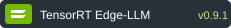
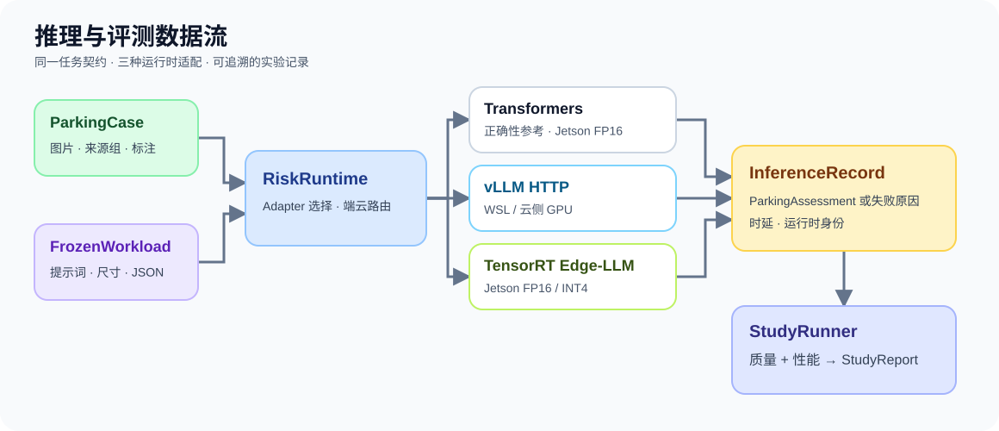
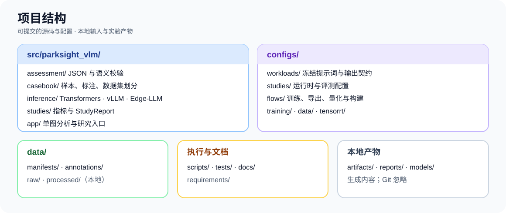

# EdgeCloud-Inference

<p>
  
</p>

<p>
  
  
</p>

<p>
  
  
  
</p>

面向低速泊车场景的视觉语言模型研究与部署项目。项目围绕
`Qwen/Qwen3-VL-2B-Instruct` 搭建风险理解、领域 LoRA 适配、INT4 AWQ 量化、
TensorRT Edge-LLM 部署和可审计评测链路。

## 从这里开始

| 要做什么 | 入口 |
| --- | --- |
| 了解输入、输出和模块关系 | [功能与输出](#功能与输出) · [系统架构](docs/architecture.md) |
| 查看已测性能与适用范围 | [性能](#性能) · [评测口径](docs/evaluation.md) |
| 在 WSL 开发、运行无硬件测试 | [开发地图](docs/development/README.md) |
| 部署 vLLM 或 Jetson Edge-LLM | [部署与运行地图](docs/ops/README.md) |
| 查找配置、脚本和全部文档 | [配置地图](configs/README.md) · [脚本地图](scripts/README.md) · [文档总览](docs/README.md) |

仅验证仓库代码时使用 Python 3.10+ 和 `uv`，无需模型权重或 GPU：

```bash
uv run python -m unittest discover -s tests
```

## 技术栈与固定版本

| 组件 | 版本或固定身份 | 用途 |
|---|---|---|
| Python | `>=3.10` | 项目运行环境 |
| Qwen3-VL | `Qwen/Qwen3-VL-2B-Instruct`，revision `89644892e4d85e24eaac8bacfd4f463576704203` | 基础视觉语言模型 |
| Transformers | 服务器 `5.9.0`；Jetson `4.57.6` | 训练、质量参考和 Jetson FP16 基线 |
| vLLM | WSL `0.11.2`；云侧版本按部署记录 | GPU OpenAI-compatible HTTP 服务、批处理与端云路由 |
| PyTorch | 服务器 `2.8.0+cu128`；Jetson `2.9.1` | 训练与推理 |
| PEFT / Accelerate | `0.18.0` / `1.10.1` | LoRA 训练 |
| ModelOpt | `0.44.0` | INT4 AWQ 量化 |
| TensorRT Edge-LLM | `v0.9.1`，commit `7f061f21f0a581ba234a1e233c9315b89d8e47d6` | Jetson runtime、导出和 engine 构建 |
| JetPack / CUDA / TensorRT | `6.2.2` / `12.6` / `10.3` | Jetson Orin Nano 板端环境 |

默认评测配置为 `configs/workloads/parking_risk_v2_strict_json.json`：`448x448` 输入、最多 256 个新 token、确定性生成，输出符合 `parking_risk_v1` 的 JSON。

## 功能与输出

输入为单张泊车场景图片，输出为一个严格校验的 `ParkingAssessment`：

```json
{
  "schema_version": "parking_risk_v1",
  "risk_level": "medium",
  "events": ["narrow_passage"],
  "evidence": ["车辆两侧空间较窄，可用横向通行区域有限。"],
  "driver_advice": ["slow_down", "maintain_observation"]
}
```

字段约束如下：

- `risk_level`：只能为 `low`、`medium` 或 `high`，表示场景整体风险。
- `events`：固定六类事件的多标签数组，可以为空。
- `evidence`：与图片可见线索对应的简短说明，不是思维链。
- `driver_advice`：枚举式安全提示，不是车辆控制指令。
- `prepare_to_stop`：表示高风险场景下随时准备停车，不表示“准备泊入车位”。

核心调用链为：

```text
ParkingCase -> RiskRuntime -> InferenceRecord -> StudyReport
```



支持服务器 Transformers 正确性参考与 vLLM HTTP 服务、Edge-LLM/vLLM HTTP 端云路由、
Jetson Transformers FP16、TensorRT Edge-LLM FP16、领域 LoRA、合并模型和 LLM backbone
INT4 AWQ 研究。服务器结果
用于质量和误差分析；板端性能只比较 Jetson 上的 runtime。

## 性能

以下为 `ps20_pilot_v1` 单图请求结果，与默认 v2 workload 不同。Jetson 为 15W 模式，WSL 为 RTX 4060 Laptop；设备与统计窗口不同，不能用跨设备数字计算加速比。同机 TensorRT level 0/1 为 builder 变量对照。

| 设备 / 运行时 | 请求 | 客户端 TTFT | E2E p50 / p90 / p99 | 输出吞吐 |
| --- | ---: | ---: | ---: | ---: |
| Jetson Transformers FP16 基线 | 1×20 | 716.69 ms | 9.569 / 14.439 / 28.155 s | 7.35 tok/s |
| Jetson TensorRT Edge-LLM INT4，level 0 | 3×20 | 872.66 ms | 10.523 / 11.387 / 12.723 s | 7.32 tok/s |
| Jetson TensorRT Edge-LLM INT4，level 1 | 3×20 | 702.50 ms | 2.826 / 2.953 / 3.315 s | 27.27 tok/s |
| WSL vLLM BF16，eager，单序列 | 1×20 | 33.04 ms（p50） | 1.456 / 2.221 / 2.412 s | 51.476 tok/s |

Jetson 吞吐按输出 token 总数除以各请求耗时之和；vLLM 按执行墙钟时间计算。Jetson TTFT 为报告汇总值，vLLM 为 HTTP 首个非空文本片段的 p50。口径见 [运行时性能测量](docs/runtime-performance.md)。

### TensorRT Edge-LLM 优化

- **Builder level 0 → 1**：固定模型、INT4 权重、视觉 engine、profile 和 CUDA Graph，仅调整 LLM builder 优化级别；E2E p50 从 10.523 s 降至 2.826 s，低层 decode 从 126.78 降至 27.47 ms/token。主要变化在 `lm_head` GEMM tactic；level 1 仍为候选。
- **P0/P1 算子**：用 C++ benchmark、Nsight 和 Engine Inspector 定位 prefill/decode 与 `lm_head`、INT4 GEMV 热点；Q/K/V 和 gate/up 融合候选使 PS20 吞吐提升 1.79%–1.99%，尚未成为默认配置。
- **P2 动态批处理**：修复 batch eviction、sampling indices 和 cache compact，加入 HTTP microbatch scheduler。同服务 c=1→4→1 吞吐为 27.259→40.169→27.261 tok/s，三段各 60/60 成功且输出一致。
- **P3 paged KV**：接通 builder、plugin、page table 与 KV 写入，并按布局处理 eviction。c=1→4→1 各 60/60 严格 JSON 有效；c=4 的 100 请求 soak 吞吐 40.154 tok/s。长输入一致性尚未通过，默认 engine 不变。

level 0/1 的运行时 profile 峰值内存分别为 4,030.4 / 4,040.1 MB。实验条件与证据见 [优化阶段速览](docs/tensorrt-optimization-summary.md)和[完整实验记录](docs/tensorrt-optimization.md)。

## 项目结构



```text
src/parksight_vlm/
  assessment/       # ParkingAssessment、严格 JSON schema 和语义审计
  casebook/         # ParkingCase、annotation、manifest 和 split 校验
  inference/        # Transformers / TensorRT Edge-LLM adapters
  studies/          # InferenceRecord、指标、性能和 StudyReport
  app/              # 单图分析、Study 入口和 runtime factory
configs/
  workloads/        # 冻结 prompt、生成参数、输入尺寸和 schema
  studies/          # server、jetson、wsl 与 archive 研究配置
  flows/            # train、merge、quantize、export、build 与 archive 流程
data/
  manifests/        # 可提交的样本元数据
  annotations/      # 可提交的标注
  raw/               # 本地图片输入，默认不进入 Git
scripts/             # 常用运行入口；data、diagnostics、experiments 专项脚本
tests/               # 按模块、训练、TensorRT 和 benchmark 分组的无硬件测试
docs/                # 架构、数据、评测、部署和过程记录
artifacts/           # adapter、ONNX、权重和 engine，本地生成
reports/             # StudyReport 和运行证据，本地生成
models/              # 本地模型权重，默认不进入 Git
```

`inference/` 也包含 vLLM HTTP Adapter 与端云路由；本地输入及产物默认不进入 Git。模块接口见[系统架构](docs/architecture.md)，可提交文件与本地产物的边界见[开发地图](docs/development/README.md)。

## 使用方法

### 安装与无硬件测试

```powershell
py -3.12 -m venv .venv
& ".\.venv\Scripts\python.exe" -m pip install -e .
$env:PYTHONPATH = "src"
& ".\.venv\Scripts\python.exe" -m unittest discover -s tests -v
```

### 单图推理

Transformers 单图示例：

```powershell
$env:PYTHONPATH = "src"
& ".\.venv\Scripts\python.exe" -m parksight_vlm.app.analyze_image `
  --image data\raw\example.jpg `
  --workload configs\workloads\parking_risk_v2_strict_json.json `
  --runtime transformers `
  --backend-revision transformers-5.9.0 `
  --model-revision 89644892e4d85e24eaac8bacfd4f463576704203 `
  --precision bf16
```

LoRA 加 `--adapter-path`；Jetson / vLLM HTTP 分别使用 `--runtime tensorrt_edge_llm_http --edge-url` 和 `--runtime vllm_http --vllm-url`。WSL 配置见[vLLM 部署](docs/vllm-wsl-deployment.md)。

### 运行配置化 Study

```powershell
$env:PYTHONPATH = "src"
Copy-Item configs\studies\server\server_vllm_http_ps20_pilot.example.json `
  configs\studies\server\server_vllm_http_ps20_pilot.local.json
& ".\.venv\Scripts\python.exe" -m parksight_vlm.app.run_study `
  --config configs\studies\server\server_vllm_http_ps20_pilot.local.json
```

在配置副本中填写服务地址和部署身份；Jetson Study 使用对应板端配置。报告写入配置指定的 `reports/` 路径。

### 训练前门禁

训练前校验数据、划分、工作负载和模型路径：

```powershell
$env:PYTHONPATH = "src"
& ".\.venv-train\Scripts\python.exe" scripts\finetune_qwen3_vl_lora.py `
  --config configs\training\qwen3_vl_2b_lora_ps64_reviewed_v1.json `
  --validate-only
```

训练、导出和构建入口见 [操作手册](docs/operations.md)；板端步骤见
[Edge-LLM 部署](docs/edgellm-deployment.md)。

## 文档入口

- [文档总览](docs/README.md)：按架构、实验、部署和历史记录查找事实来源。
- [开发地图](docs/development/README.md)：模块、配置、测试和可提交文件。
- [部署与运行地图](docs/ops/README.md)：WSL vLLM、Jetson Edge-LLM、评测及排障。
